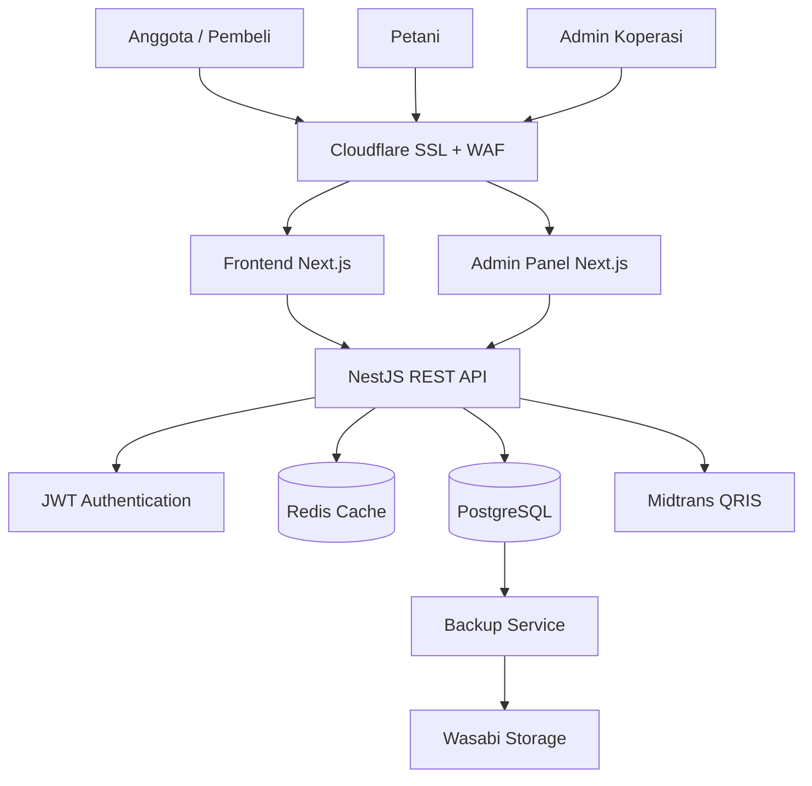
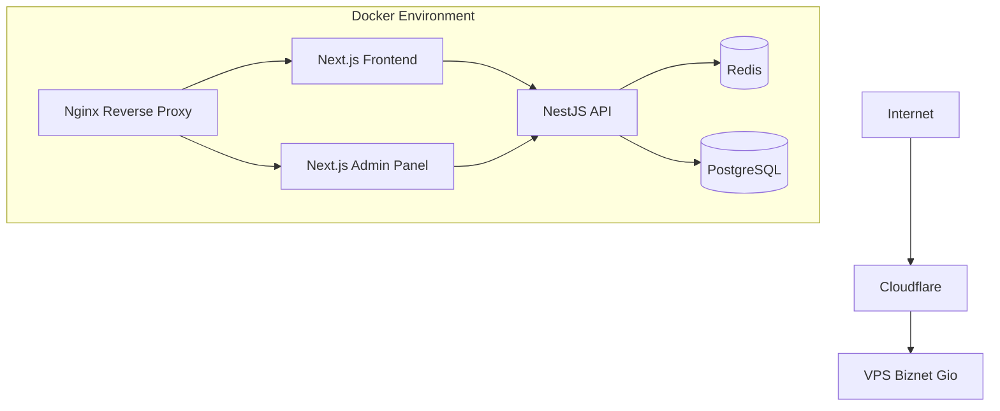
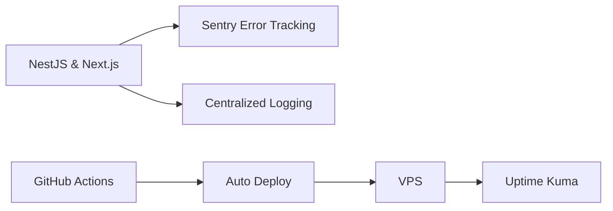
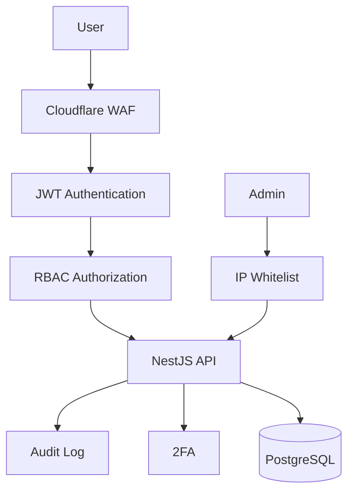

# Arsitektur Sistem Koperasi Sinar Pagi Sejahtera

## Overview

Sistem Koperasi Sinar Pagi Sejahtera dibangun menggunakan arsitektur modern berbasis service-oriented application dengan pemisahan Frontend, Backend, Database, Cache, dan layanan pihak ketiga untuk memastikan performa, keamanan, dan skalabilitas.

Teknologi utama:

* Frontend: Next.js + Tailwind CSS
* Admin Panel: Next.js + Shadcn UI + Tailwind CSS
* Backend API: NestJS
* Database: PostgreSQL
* Cache & Queue: Redis
* Authentication: Passport.js + JWT + Google OAuth
* Payment Gateway: Midtrans
* Reverse Proxy & SSL: Cloudflare
* Backup Storage: Wasabi
* Containerization: Docker & Docker Compose

---

# High Level Architecture



---

# Deployment Architecture



---

# Monitoring & Reliability



Monitoring stack:

* Uptime Kuma / UptimeRobot
* Sentry
* Grafana Loki / Papertrail
* GitHub Actions
* Docker Health Check

---

# Security Architecture



Security Features:

* JWT Authentication
* Google OAuth
* Role Based Access Control (RBAC)
* Audit Log
* Two-Factor Authentication (2FA)
* Maker Checker Approval
* IP Whitelisting Admin
* CSP Header
* HSTS Header
* Secrets Management

---

# Role & Access Management

## Admin Koperasi

Hak akses:

* Kelola petani
* Kelola pembeli
* Kelola produk
* Kelola transaksi
* Approval pengguna
* Laporan keseluruhan

## Petani / Penjual

Hak akses:

* Kelola produk
* Kelola stok
* Kelola pesanan
* Melihat pendapatan
* Riwayat penjualan

## Pembeli

Hak akses:

* Cari produk
* Checkout
* Pembayaran QRIS
* Tracking pesanan
* Riwayat pembelian
* Rating dan ulasan

---

# Performance Optimization

* Redis Caching
* Lazy Loading
* Code Splitting
* Next.js Image Optimization
* Database Indexing
* CDN Cloudflare
* Pagination
* Query Optimization
* Brotli Compression
* Gzip Compression

---

# Backup Strategy

Standar Backup: 3-2-1 Backup Strategy

* 3 salinan data
* 2 media penyimpanan berbeda
* 1 salinan berada di lokasi berbeda

Primary Storage:

* PostgreSQL

Backup Storage:

* Wasabi Object Storage

Backup Schedule:

* Daily Database Backup
* Weekly Full Backup
* Monthly Archive Backup

---

# Infrastruktur Awal

| Komponen   | Spesifikasi          |
| ---------- | -------------------- |
| VPS        | 4 vCPU               |
| RAM        | 8 GB                 |
| Storage    | SSD                  |
| Database   | PostgreSQL           |
| Cache      | Redis                |
| SSL        | Cloudflare           |
| Container  | Docker Compose       |
| Backup     | Wasabi               |
| Monitoring | Uptime Kuma + Sentry |

Target kapasitas awal:

* > 2000 anggota aktif
* Dapat ditingkatkan secara horizontal ketika trafik meningkat
* Siap untuk migrasi ke Docker Swarm atau Kubernetes apabila skala sistem bertambah besar

```

Dokumen ini disusun dari spesifikasi stack, monitoring, optimasi, keamanan, dan role yang terdapat pada file yang Anda unggah.

Jika ingin untuk GitHub repository, saya juga bisa membuat versi yang lebih lengkap dengan **C4 Diagram, ERD PostgreSQL, dan folder structure NestJS + Next.js monorepo**.
```
