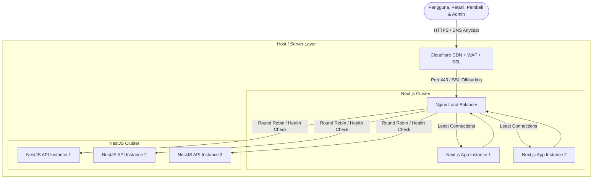
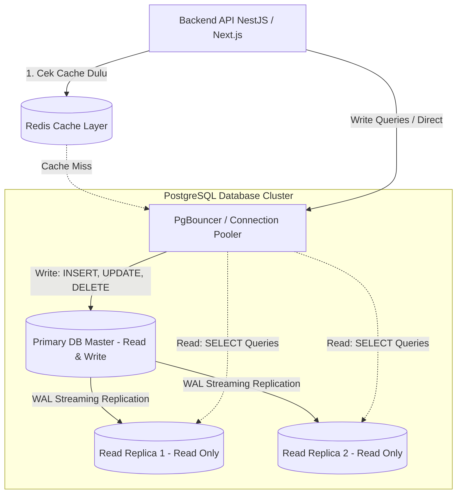
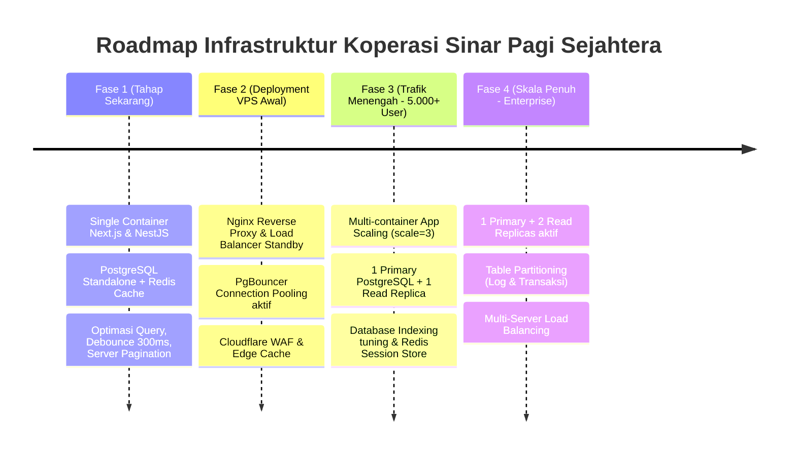

# Koperasi Sinar Pagi Sejahtera — Arsitektur Skalabilitas & Deployment

Repositori ini memuat rancangan dan implementasi sistem digital agribisnis **Koperasi Sinar Pagi Sejahtera** (Minahasa Utara). Dokumen ini berfokus pada **spesifikasi teknis deployment**, penerapan **Load Balancer**, serta strategi **skalabilitas dan optimasi database** dari skala awal hingga skala besar (*high-traffic enterprise*).

---

## Daftar Isi
1. [Arsitektur Deployment & Load Balancing](#1-arsitektur-deployment--load-balancing)
2. [Strategi Optimasi Database](#2-strategi-optimasi-database)
   - [A. Query Optimization & Indexing](#a-query-optimization--indexing)
   - [B. Redis Caching Layer](#b-redis-caching-layer)
   - [C. Database Connection Pooling](#c-database-connection-pooling)
   - [D. Database Sharding & Partitioning](#d-database-sharding--partitioning)
   - [E. Read Replicas (1 Primary + 2 Replicas)](#e-read-replicas-1-primary--2-replicas)
3. [Roadmap Skalabilitas Bertahap](#3-roadmap-skalabilitas-bertahap)
4. [Contoh Konfigurasi Deployment](#4-contoh-konfigurasi-deployment)

---

## 1. Arsitektur Deployment & Load Balancing

Pada tahap deployment produksi, sistem tidak lagi menggunakan satu proses tunggal (*single instance*), melainkan menerapkan arsitektur **Load Balanced Cluster** di balik Cloudflare dan Nginx / Traefik:



### Karakteristik Load Balancer
* **Algoritma Distribusi**: Menggunakan `least_conn` (mengarahkan request ke server dengan beban koneksi paling sedikit) untuk API request yang berat, dan `round-robin` untuk aset web.
* **Health Check Otomatis**: Nginx memantau endpoint `/api/health`. Jika satu container mengalami *crash* atau *restarting*, trafik langsung dialihkan ke instance yang sehat secara instan tanpa *downtime*.
* **SSL Offloading & Compression**: Dekripsi TLS dilakukan di level Cloudflare dan Nginx, serta kompresi Brotli/Gzip otomatis untuk menghemat bandwidth server.

---

## 2. Strategi Optimasi Database

Untuk mengantisipasi lonjakan data petani, pembeli, produk, dan transaksi agribisnis, database PostgreSQL dioptimasi melalui 5 lapis penanganan:



---

### A. Query Optimization & Indexing
1. **Penerapan B-Tree & Compound Indexing**:
   Kolom yang paling sering dipakai pada klausa `WHERE`, `ORDER BY`, dan `JOIN` diberikan indeks spesifik:
   ```prisma
   model User {
     id         String   @id @default(uuid())
     email      String   @unique
     role       Role     @default(PEMBELI)
     isVerified Boolean  @default(false)
     createdAt  DateTime @default(now())

     @@index([role, isVerified])      // Compound index filter pengguna
     @@index([createdAt(sort: Desc)])  // Index sorting tabel data
   }
   ```
2. **Server-Side Pagination Menggunakan Offset & Limit Efisien**:
   * Menghindari `SELECT *` besar dengan membatasi payload data menggunakan `skip` dan `take`.
   * Menggunakan proyeksi field (`select: { id: true, name: true }`) untuk mengurangi beban memori server.

---

### B. Redis Caching Layer
* **Pola Cache-Aside**:
  * Ketika API meminta data (misal katalog produk, profil admin, atau data referensi Kelompok Tani), backend memeriksa Redis terlebih dahulu.
  * Jika ada (*Cache Hit*), data langsung dikembalikan dalam hitungan < 2 milidetik tanpa menyentuh PostgreSQL.
  * Jika tidak ada (*Cache Miss*), data diambil dari database, disimpan ke Redis dengan TTL (misal: 15–60 menit), lalu dikembalikan ke pengguna.
* **Cache Invalidation**:
  * Ketika admin melakukan perubahan (CREATE, UPDATE, DELETE), cache terkait otomatis dihapus (*purge*) sehingga data selalu akurat.

---

### C. Database Connection Pooling
Secara default, setiap koneksi baru ke PostgreSQL menghabiskan 2–10 MB memori per thread. Ketika ratusan user mengakses web secara bersamaan, database bisa kehabisan memori (*Out of Memory*).

* **Solusi**: Menggunakan **PgBouncer** atau **Prisma Connection Pooling**:
  * Menjaga sekumpulan koneksi siap pakai (*pool*) berukuran optimal (misal 20–50 koneksi aktif).
  * Ribuan *incoming requests* berbagi koneksi yang sama secara bergantian (*Transaction Pooling Mode*).
  * Mencegah lonjakan koneksi yang dapat menjatuhkan server database.

---

### D. Database Sharding & Partitioning
Ketika data transaksi, faktur pesanan, dan log audit bertambah menjadi jutaan baris:
* **Table Partitioning (Range Partitioning)**:
  Tabel transaksi (`transactions` / `orders`) dipartisi berdasarkan rentang waktu:
  * `transactions_2026_q1`
  * `transactions_2026_q2`
  * `transactions_2026_q3`, dst.
* **Sharding (Horizontal Scaling)**:
  Membagi database ke beberapa server fisik/virtual berdasarkan ID Wilayah / Kecamatan (misal: Shard Minahasa Utara, Shard Manado, dll.) sehingga beban I/O penyimpanan terbagi merata.

---

### E. Read Replicas (1 Primary + 2 Replicas)
Dalam aplikasi koperasi, **80–90% operasi adalah membaca data** (*Read: melihat katalog, data petani, riwayat, dashboard*) dan hanya **10–20% operasi menulis data** (*Write: pendaftaran, checkout, verifikasi*).

Arsitektur **1 Primary + 2 Read Replicas** memisahkan jalur baca dan tulis:

| Node Database | Peran | Tugas Operasi |
| :--- | :--- | :--- |
| **Primary (Master)** | Single Source of Truth | Menangani semua operasi **INSERT, UPDATE, DELETE**, dan transaksi finansial sensitif. |
| **Read Replica 1** | Salinan Asinkron (Read-Only) | Menangani 50% query **SELECT** (pencarian produk, data table pembeli & petani). |
| **Read Replica 2** | Salinan Asinkron (Read-Only) | Menangani 50% query **SELECT** lainnya, pelaporan admin, dan pencadangan harian (*backup dump*). |

#### Implementasi Read/Write Splitting pada Prisma
Backend mengarahkan query berdasarkan jenis operasinya:
```ts
// Konfigurasi Prisma Client dengan Extension Read Replica
import { PrismaClient } from '@prisma/client';
import { readReplicas } from '@prisma/extension-read-replicas';

export const prisma = new PrismaClient({
  datasourceUrl: process.env.DATABASE_URL_PRIMARY, // Primary untuk WRITE
}).$extends(
  readReplicas({
    url: [
      process.env.DATABASE_URL_REPLICA_1!,         // Replica 1 untuk READ
      process.env.DATABASE_URL_REPLICA_2!,         // Replica 2 untuk READ
    ],
  })
);
```

---

## 3. Roadmap Skalabilitas Bertahap



---

## 4. Contoh Konfigurasi Deployment

### A. Blok Nginx Upstream Load Balancing
```nginx
# /etc/nginx/conf.d/koperasi_lb.conf

upstream backend_cluster {
    least_conn;
    server 127.0.0.1:3001 max_fails=3 fail_timeout=10s;
    server 127.0.0.1:3002 max_fails=3 fail_timeout=10s;
    keepalive 32;
}

upstream frontend_cluster {
    server 127.0.0.1:3000 max_fails=3 fail_timeout=10s;
    server 127.0.0.1:3003 max_fails=3 fail_timeout=10s;
    keepalive 32;
}

server {
    listen 80;
    server_name sinarpagisejahtera.co.id www.sinarpagisejahtera.co.id;
    return 301 https://$host$request_uri;
}

server {
    listen 443 ssl http2;
    server_name sinarpagisejahtera.co.id www.sinarpagisejahtera.co.id;

    # SSL Certificates
    ssl_certificate /etc/ssl/certs/koperasi.crt;
    ssl_certificate_key /etc/ssl/certs/koperasi.key;

    # Frontend Route
    location / {
        proxy_pass http://frontend_cluster;
        proxy_http_version 1.1;
        proxy_set_header Upgrade $http_upgrade;
        proxy_set_header Connection 'upgrade';
        proxy_set_header Host $host;
        proxy_cache_bypass $http_upgrade;
    }

    # API Backend Route
    location /api/ {
        proxy_pass http://backend_cluster;
        proxy_http_version 1.1;
        proxy_set_header Host $host;
        proxy_set_header X-Real-IP $remote_addr;
        proxy_set_header X-Forwarded-For $proxy_add_x_forwarded_for;
        proxy_set_header X-Forwarded-Proto $scheme;
    }
}
```

### B. Docker Compose Multi-Replica (Production Preview)
```yaml
services:
  # Load Balancer
  nginx_lb:
    image: nginx:alpine
    ports:
      - "80:80"
      - "443:443"
    volumes:
      - ./nginx/nginx.conf:/etc/nginx/nginx.conf:ro
    depends_on:
      - backend
      - frontend

  # Backend Services (Dapat di-scale via: docker compose up --scale backend=3)
  backend:
    build: ./backend
    restart: always
    environment:
      DATABASE_URL_PRIMARY: "postgresql://user:pass@pg_primary:5432/koperasi_db"
      DATABASE_URL_REPLICA_1: "postgresql://user:pass@pg_replica1:5432/koperasi_db"
      DATABASE_URL_REPLICA_2: "postgresql://user:pass@pg_replica2:5432/koperasi_db"
      REDIS_URL: "redis://koperasi_redis:6379"

  # PostgreSQL Primary (Write Master)
  pg_primary:
    image: postgres:16-alpine
    environment:
      POSTGRES_DB: koperasi_db
    volumes:
      - pg_primary_data:/var/lib/postgresql/data

  # PostgreSQL Read Replica 1
  pg_replica1:
    image: postgres:16-alpine
    environment:
      PGUSER: replicator
    depends_on:
      - pg_primary

  # PostgreSQL Read Replica 2
  pg_replica2:
    image: postgres:16-alpine
    environment:
      PGUSER: replicator
    depends_on:
      - pg_primary

  # Redis Cache
  koperasi_redis:
    image: redis:7-alpine
    command: redis-server --appendonly yes
    volumes:
      - redis_data:/data

volumes:
  pg_primary_data:
  redis_data:
```

---

*Dokumentasi ini disiapkan sebagai standar acuan arsitektur produksi tim pengembang Koperasi Sinar Pagi Sejahtera.*
