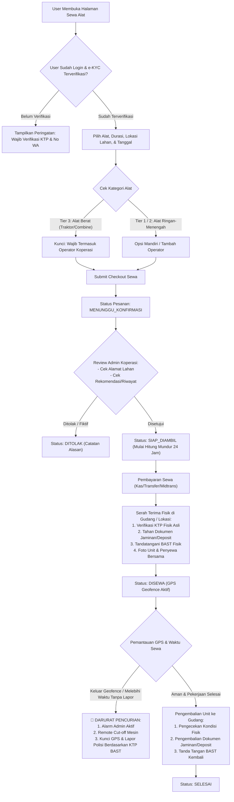

# Strategi Keamanan & Mitigasi Risiko Pencurian Sewa Alat Pertanian
**Koperasi Produsen Pertanian Sinar Pagi Sejahtera**

Dokumen ini merinci logika bisnis, standar operasional prosedur (SOP), mitigasi hukum/finansial, serta arsitektur teknis untuk mencegah dan menangani risiko **pencurian/penggelapan alat mesin pertanian (alsintan)** melalui akun palsu (*dummy/fake account*).

---

## 1. Latar Belakang & Identifikasi Ancaman (Threat Modeling)

### Skenario Ancaman:
1. **Pendaftaran Fiktif:** Pelaku membuat akun baru dengan email sementara (*disposable email*) dan nomor telepon palsu/acak.
2. **Pengajuan Sewa Aset Bernilai Tinggi:** Pelaku mengajukan sewa alat bernilai puluhan hingga ratusan juta rupiah (seperti Traktor Roda 4, Mini Excavator, atau Combine Harvester).
3. **Pengambilan & Pelarian (Lepas-Kunci):** Pelaku mengambil alat dari gudang atau minta dikirim ke lahan palsu, kemudian memuat alat ke truk dan membawanya kabur ke luar daerah/pulau untuk dijual atau dipreteli.

---

## 2. Kerangka Pengamanan 4 Lapis (Defense-in-Depth)

Untuk mengatasi skenario di atas, sistem mengombinasikan 4 lapis perlindungan:

```
┌────────────────────────────────────────────────────────┐
│               LAPIS 1: VERIFIKASI DIGITAL (KYC)         │
│  (OTP WhatsApp, Upload KTP + Selfie, Validasi Komunitas)│
└───────────────────────────┬────────────────────────────┘
                            │
┌───────────────────────────▼────────────────────────────┐
│          LAPIS 2: JAMINAN HUKUM & FINANSIAL            │
│ (Deposit Uang/Fisik Asli, BAST Bermaterai, Pasal 372)  │
└───────────────────────────┬────────────────────────────┘
                            │
┌───────────────────────────▼────────────────────────────┐
│          LAPIS 3: OPERASIONAL & OPERATOR RESMI         │
│(Skema Wajib Operator Koperasi untuk Alsintan Bernilai Tinggi)│
└───────────────────────────┬────────────────────────────┘
                            │
┌───────────────────────────▼────────────────────────────┐
│          LAPIS 4: HARDWARE & IOT TRACKING              │
│ (GPS Tracker Tanam, Geofencing Zona Aman, Cut-Off Relay) │
└────────────────────────────────────────────────────────┘
```

---

### Lapis 1: Verifikasi Akun & Identitas Digital (Anti-Akun Bodong)

1. **Wajib OTP WhatsApp / SMS Resmi:**
   - Menghilangkan kemungkinan nomor telepon fiktif. Kode OTP hanya dikirimkan ke nomor WhatsApp aktif yang terhubung dengan pengguna.
2. **e-KYC KTP & Selfie Memegang KTP:**
   - Untuk layanan sewa alat, penyewa **wajib** mengunggah:
     - Foto e-KTP asli (jelas, tidak buram, nama & NIK terbaca).
     - Foto *selfie* memegang e-KTP.
   - Admin koperasi melakukan verifikasi identitas (status verifikasi akun: `UNVERIFIED` → `PENDING` → `VERIFIED`).
3. **Validasi Komunitas & Kelompok Tani (Sistem Afiliasi):**
   - Koperasi berbasis teritorial lokal. Pengguna baru diminta mencantumkan **Kelompok Tani** atau **Rekomendasi Anggota Koperasi/Kepala Dusun**.
   - Akun tanpa riwayat dan tanpa afiliasi kelompok tani tidak diizinkan menyewa alat berat secara lepas-kunci.

---

### Lapis 2: Jaminan Finansial & Hukum (Legal Protection)

1. **Jaminan Fisik Asli Saat Serah Terima:**
   - Pada saat pengambilan alat di gudang (status `SIAP_DIAMBIL`), penyewa wajib menitipkan dokumen fisik asli:
     - e-KTP fisik asli / SIM asli, atau
     - BPKB / STNK kendaraan yang digunakan untuk menjemput alat.
   - Alternatif: Pemberlakuan *Security Deposit* (uang jaminan) yang ditahan dan dikembalikan 100% setelah alat kembali dalam kondisi baik.
2. **Berita Acara Serah Terima (BAST) & Surat Perjanjian Sewa Bermaterai:**
   - Penyerahan alat wajib ditandai dengan penandatanganan BAST fisik, mencakup:
     - Nomor seri mesin (*serial number* / nomor rangka mesin).
     - Kondisi fisik awal, jam kerja alat (*hour meter*), level bahan bakar.
     - Foto dokumentasi bersama penyewa memegang BAST di samping unit alat.
   - Klausul hukum tegas merujuk **Pasal 372 KUHP (Tindak Pidana Penggelapan)** dan **Pasal 378 KUHP (Penipuan)** jika alat tidak dikembalikan sesuai jadwal tanpa konfirmasi.

---

### Lapis 3: Kebijakan Operasional "Wajib dengan Operator"

Pemisahan aturan berdasarkan nilai aset (*Tiering Asset*):

| Kategori Alat | Contoh Alat | Estimasi Harga Unit | Aturan Sewa |
|---|---|---|---|
| **Tier 1 (Alat Ringan)** | Handsprayer elektrik, cangkul, pompa air mini, selang spiral | Rp 500rb – Rp 5jt | Lepas-kunci diperbolehkan, wajib deposit/KTP asli ditahan. |
| **Tier 2 (Alat Menengah)** | Kultivator, traktor tangan roda 2, mesin potong rumput dorong | Rp 10jt – Rp 35jt | Lepas-kunci hanya untuk anggota terverifikasi; non-anggota wajib didampingi/deposit tinggi. |
| **Tier 3 (Alat Berat / Alsintan Utama)** | Traktor Roda 4, Combine Harvester, Drone Pertanian, Transplanter | Rp 70jt – Rp 500jt+ | **WAJIB dengan Operator Resmi Koperasi (`includeOperator: true`).** Alat tidak pernah ditinggal tanpa pengawasan personil koperasi. Unit wajib pulang ke gudang setiap sore. |

---

### Lapis 4: Teknologi IoT (GPS Tracker & Remote Cut-Off)

Untuk seluruh alsintan bermesin (Tier 2 & Tier 3):

1. **GPS Tracker Tanam (Hardwired + Baterai Cadangan Internal):**
   - GPS dipasang tersembunyi di dalam sasis atau kotak mesin (bukan soket pemantik/OBD yang mudah dicabut).
   - Dilengkapi baterai internal yang tetap memancarkan sinyal GPS meski aki alat dicabut.
2. **Geofencing (Pembatasan Zona Lahan):**
   - Admin menentukan perimeter koordinat kerja alat (misal: radius 15 km di area lahan Minahasa Utara).
   - Jika alat terdeteksi bergerak keluar dari zona batas (misalnya terdeteksi melaju di jalan raya antar-kota menuju pelabuhan), sistem mengirimkan peringatan darurat (*High Alert*) ke admin koperasi via WhatsApp/Telegram.
3. **Engine Immobilizer (Remote Cut-Off Relay):**
   - Saklar pemutus arus jarak jauh yang terhubung ke pompa bahan bakar atau dinamo starter.
   - Jika terjadi indikasi pencurian, admin dapat menekan tombol **"Nonaktifkan Mesin"** di dashboard admin, sehingga mesin langsung mati dan tidak dapat distarter kembali.

---

## 3. Diagram Alur Sistem (Flowchart Operasional & Sistem)



---

## 4. Rencana Realisasi Teknis pada Aplikasi (Development Roadmap)

### Fase 1: Validasi Identitas (Di Aplikasi Web)
1. **Tambahkan Kolom di Model User (Prisma):**
   ```prisma
   enum KycStatus {
     UNVERIFIED
     PENDING
     VERIFIED
     REJECTED
   }

   model User {
     // ... field yang sudah ada
     nik           String?
     ktpPhotoUrl   String?
     selfieKtpUrl  String?
     kycStatus     KycStatus @default(UNVERIFIED)
     kelompokTani  String?
   }
   ```
2. **Validasi Checkout Sewa Alat:**
   - Tambahkan *guard* pada halaman `/checkout/sewa-alat`: Jika `user.kycStatus !== 'VERIFIED'`, redirect ke halaman verifikasi atau tampilkan modal upload KTP.

### Fase 2: Checklist BAST & Dokumen Jaminan (Di Dashboard Admin)
1. Pada detail pesanan sewa (`/admin/pesanan` atau modal detail sewa), sediakan checklist sebelum mengubah status menjadi `DISEWA`:
   - [ ] Nomor KTP fisik cocok dengan data aplikasi.
   - [ ] Dokumen jaminan (KTP fisik/SIM/Deposit) telah diterima gudang.
   - [ ] Form BAST telah ditandatangani dan difoto bersama penyewa.
   - [ ] Upload foto bukti serah terima unit.

### Fase 3: Integrasi IoT GPS Tracker (Jangka Menengah)
1. Pengadaan perangkat GPS Tracker tipe relay (misal: Sinotrack ST-901 / Concox GT06N).
2. Endpoint Webhook API `/api/iot/gps-tracker` untuk menerima koordinat berkala (latitude, longitude, speed, engine status).
3. Peta visualisasi armada alat di admin dashboard dengan garis batas *geofencing*.

---

## 5. Ringkasan Kesimpulan

Dengan menerapkan sistem berlapis ini:
- **Pelaku tidak bisa menggunakan identitas palsu**, karena wajib OTP nomor aktif dan verifikasi fisik e-KTP.
- **Pelaku tidak bisa membawa kabur alat berat secara diam-diam**, karena alat wajib dikemudikan oleh operator koperasi sendiri atau dipantau oleh GPS Tracker tanam dengan relay pemutus mesin.
- **Koperasi memiliki dasar hukum dan identitas pasti**, sehingga jika terjadi pelanggaran, proses hukum dapat langsung diproses dengan data dan bukti yang lengkap.
